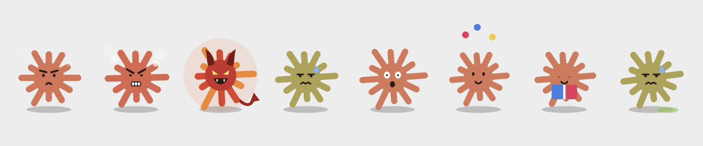
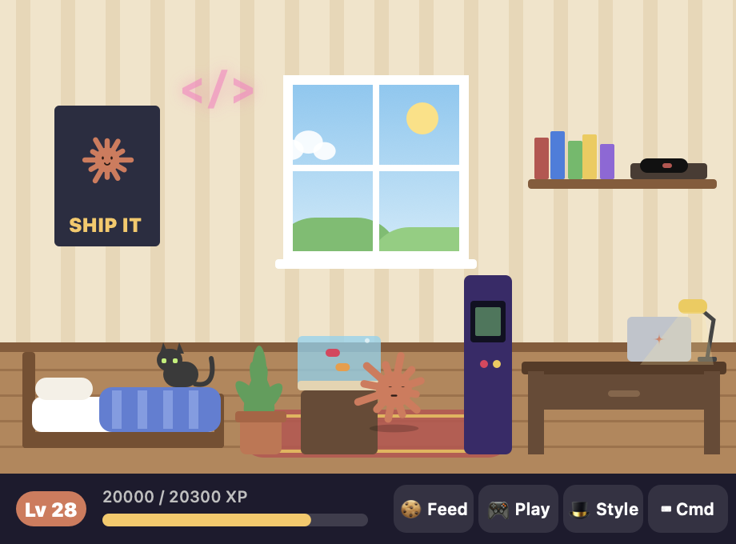

# Claude Buddy

A tiny desktop companion for **Claude Code** on macOS. It sits in the corner of your screen and
reacts to your Claude Code sessions. It thinks while Claude works, celebrates when a task is done,
and waves at you when Claude needs your permission. It also has its own little world: a room, XP,
unlockables, mini-games, secrets and quite a temper.



> Unofficial fan project. Not affiliated with or endorsed by Anthropic. "Claude" is a trademark of Anthropic.

## Features

- **Knows what Claude Code is doing** (through Claude Code hooks):
  - Thinking animation while a session runs.
  - Hops, sparkles and a chime when it finishes.
  - A "needs your permission" alert.
  - Click the speech bubble to jump back to your terminal.
- **Two sessions at once?** A blue friend appears, and each buddy follows its own session.
- **Its own room** (double-click buddy):
  - Buddy walks around and works at its desk while Claude runs.
  - It sleeps in bed when you're away, and the window shows the real time of day.
- **XP and levels** from finished sessions, petting, cookies and games. Leveling up unlocks:
  - **skins:** Mint, Grape, Midnight, Golden and more
  - **hats:** party hat, wizard hat, crown and more
  - **rooms:** Greenhouse, Space Station and more
  - **furniture:** plant, fish tank, arcade, a cat and more
- **Mini-games:** Bug Catch and Copycat.
- **Personality:**
  - Eyes that follow your cursor.
  - Idle routines: juggling, whistling, sneezing, coffee.
  - Random thoughts, and sounds generated live.
- **A temper.** Poke him too much, fling him across the screen, squish him or honk at him, and
  he gets angry. At the end he turns into a little devil and throws bombs across your screen. Click
  them to defuse them. 😈
- **Cookies:** too many make him sick, so keep some medicine handy.
- **Secrets.** Try typing `sudo buddy` in his room's console. There are more to find.



## Install

You need macOS 14 or later with Swift (`xcode-select --install` if you don't have it) and
[Claude Code](https://claude.com/claude-code).

```sh
git clone https://github.com/ilyaanpoint-bot/claude-buddy.git
cd claude-buddy
./install.sh            # or: ./install.sh --login   to start buddy whenever you log in
```

The installer:

1. builds the app into `~/.claude/claude-buddy/`
2. installs `hook.sh` there
3. adds five hooks to `~/.claude/settings.json`: `UserPromptSubmit`, `PostToolUse`, `Stop`,
   `Notification`, `SessionEnd`

It backs up your settings first and never removes your existing hooks. Claude Code sessions you
start after installing will talk to buddy.

To remove it: `./uninstall.sh` (your XP and unlocks are kept).

## How it works

```
Claude Code ──hooks──▶ hook.sh ──appends a JSON line──▶ ~/.claude/claude-buddy/events.jsonl
                                                                  │
                                       ClaudeBuddy.app tails it ◀─┘
```

`hook.sh` only writes the event name, session ID, working-folder path and notification message
to a local file. Nothing leaves your Mac.

## Controls

| Do this | And buddy… |
|---|---|
| Click | giggles (and earns XP) |
| Double-click | opens the room |
| Click 5 times fast | gets dizzy |
| Drag | moves; flick hard to fling him |
| Click and hold | squishes |
| Wiggle the cursor on him | is tickled |
| Right-click | opens the menu: feed, honk, tease, medicine, games, wardrobe, sounds |

## Develop

```sh
./build.sh && ./ClaudeBuddy
```

Everything is plain AppKit drawn by hand, with no assets or dependencies. The source files:

- `Character.swift`: looks and animation
- `Personality.swift`: temper and behaviours
- `Rage.swift`: the bomb tantrum
- `Room.swift`: the room
- `Copycat.swift`: the Copycat game
- `Sound.swift`, `SoundFX.swift`: the synth
- `Progress.swift`: XP and unlocks

PRs with new hats, rooms, games and secrets are very welcome.

## License

MIT
